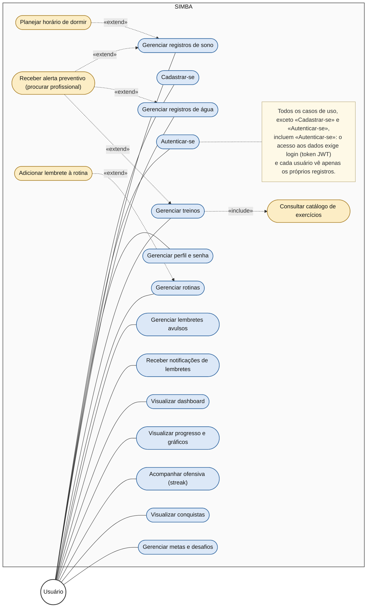
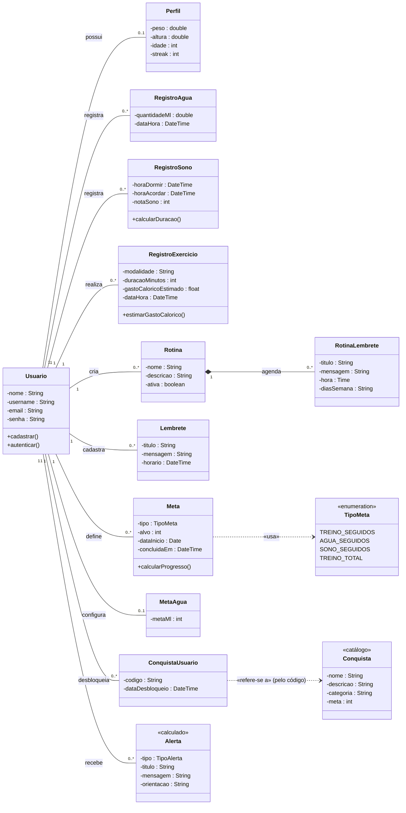

# SIMBA — Sistema Integrado de Monitoramento do Bem-estar Automatizado

> **Mufasa Softwares** · Curso de Sistemas de Informação — **UEG** (Câmpus Trindade) · Período letivo **2026/02**  
> **Disciplinas:** Construção de Software / Práticas Interdisciplinares  
> **Professores:** Heuber Gustavo Frazao de Lima e José Ricardo Cosme Lérias Ribeiro  
> **Checkpoint 02 — Versão Final das Documentações** (novembro de 2026)


-success)


%20%7C%20PostgreSQL%20(previsto)-blue)


---

## Sumário

1. [Sobre o Projeto (Documento de Visão v1.1)](#1-sobre-o-projeto-documento-de-visão-v11)
2. [Usuários do Sistema e Escopo](#2-usuários-do-sistema-e-escopo)
3. [Checklist de Requisitos (28/28 — 100%)](#3-checklist-de-requisitos-2828--100)
4. [Gestão Ágil (SCRUM) e Histórias de Usuário](#4-gestão-ágil-scrum-e-histórias-de-usuário)
5. [Modelagem do Sistema](#5-modelagem-do-sistema)
6. [Arquitetura, Tecnologias e Estrutura do Código](#6-arquitetura-tecnologias-e-estrutura-do-código)
7. [Regras de Negócio](#7-regras-de-negócio)
8. [Como Executar e Testar](#8-como-executar-e-testar)
9. [Riscos, Critérios de Sucesso e Validação](#9-riscos-critérios-de-sucesso-e-validação)
10. [Resumo Final das Entregas](#10-resumo-final-das-entregas)
11. [Equipe e Histórico de Contribuições (Sprints 1 a 7)](#11-equipe-e-histórico-de-contribuições-sprints-1-a-7)

---

## 1. Sobre o Projeto (Documento de Visão v1.1)

O **SIMBA** (**S**istema **I**ntegrado de **M**onitoramento do **B**em-estar **A**utomatizado) é uma aplicação web centralizada desenvolvida pela organização acadêmica **Mufasa Softwares** (CTO responsável: Samuel Rodrigues Filho) para reunir em um único ambiente ferramentas práticas de acompanhamento de saúde e bem-estar social.

### Problema Identificado

A busca crescente por um estilo de vida mais saudável gerou uma proliferação de aplicativos extremamente nichados e isolados. Somado à sobrecarga mental e às rotinas exaustivas no "piloto automático", em que necessidades biológicas básicas são negligenciadas, esse cenário acarreta:

- Desencorajamento e paralisia de escolha;
- Inconveniência pela quantidade de aplicações que o usuário precisa instalar;
- Fragmentação dos dados de saúde e bem-estar;
- Dificuldade em descobrir quais ferramentas são necessárias para manter o monitoramento;
- Sedentarismo crônico, desidratação ao longo do dia e agravamento de quadros de ansiedade e *burnout*.

### Justificativa

O projeto explora uma lacuna prática: centralizar múltiplas ferramentas de bem-estar e gerenciamento de rotina diária em um único lugar, com interface simples, acessível e motivadora, ao mesmo tempo em que integra conhecimentos do curso de Sistemas de Informação em Engenharia de Software, Banco de Dados, Programação, Experiência do Usuário, Segurança da Informação e Gestão de Projetos.

### Objetivo Geral

Desenvolver e implantar uma aplicação web capaz de reunir diversas ferramentas relevantes para o exercício de um estilo de vida saudável.

### Objetivos Específicos

- Permitir o cadastro de usuários;
- Registrar hábitos relacionados à saúde e ao bem-estar;
- Monitorar o consumo diário de água;
- Permitir o acompanhamento da rotina diária do usuário;
- Disponibilizar lembretes para atividades e hábitos importantes;
- Centralizar diferentes ferramentas de monitoramento de saúde e bem-estar em uma única aplicação;
- Permitir o acompanhamento da evolução dos hábitos registrados;
- Disponibilizar informações básicas sobre os indicadores de bem-estar;
- Controlar o acesso ao sistema por meio de autenticação;
- Armazenar e organizar os dados dos usuários de forma centralizada;
- Facilitar o gerenciamento de hábitos saudáveis por meio de uma interface simples e intuitiva.

### Levantamento de Requisitos

Os requisitos foram levantados e refinados por meio de três técnicas:

1. **Formulário:** questionário aplicado a potenciais usuários para mapear demandas reais;
2. **Pesquisas:** levantamento junto a profissionais da área da saúde sobre dificuldades práticas no cuidado com o bem-estar;
3. **Prototipação:** construção de *wireframes* das telas principais (Tela Principal, Perfil, Rotina, Estatísticas, Conquistas e Notificações) antes da implementação completa das interfaces web.

---

## 2. Usuários do Sistema e Escopo

### Perfis de Usuários

| Perfil | Situação | Responsabilidades |
|---|---|---|
| **Usuário Final** | **Implementado** | Cadastra-se, autentica-se, mantém perfil e senha, cria rotinas e lembretes, registra hábitos (água, sono, treinos e sinais corporais), acompanha gráficos, ofensiva (*streak*), metas e conquistas. |
| **Suporte** | *Previsto no Documento de Visão (escopo futuro)* | Ouvidoria, ajuda, orientação e monitoramento administrativo de usuários. |

### Escopo Entregue nesta Versão

- **Autenticação e Conta:** cadastro, login stateless com token **JWT**, criptografia de senha com **BCrypt**, edição de dados pessoais, troca de senha e exclusão da conta.
- **Perfil Biométrico e IMC:** cadastro/edição de peso, altura e idade, cálculo automático de **IMC** com faixas da OMS e sugestões de metas personalizadas com criação direta em Conquistas.
- **Hidratação:** registro em ml, botão rápido `+250 ml`, histórico organizado por dia (com edição e exclusão na própria tela) e meta diária personalizada (sugerida por `35 ml × peso` ou ajustável pelo usuário).
- **Sono:** registro de hora de dormir, hora de acordar e nota de 1 a 5, cálculo de duração, planejador de horários baseado em **ciclos de ~90 min** (5, 6 e 7 ciclos) e alerta após noites consecutivas de baixa qualidade.
- **Treinos:** catálogo de modalidades, registro de duração (min) e gasto calórico estimado (kcal), histórico e CRUD completo.
- **Rotinas e Lembretes:** rotinas que agrupam lembretes recorrentes (horário + dias da semana, com ativação/desativação e exclusão) e lembretes avulsos com data/hora exibidos como notificações no sino do sistema.
- **Dashboard e Engajamento:** resumo do dia, cartão de ofensiva (*streak*) com tolerância a faltas e mascote **leão em SVG** com expressões dinâmicas, cartão **"Próximo passo"** sugerido e *toasts* de feedback imediato ao registrar hábitos.
- **Conquistas e Metas:** **26 conquistas** automáticas em 6 categorias e metas/desafios personalizados (`TREINO_SEGUIDOS`, `AGUA_SEGUIDOS`, `SONO_SEGUIDOS`, `TREINO_TOTAL`) com cálculo automático de progresso.
- **Acompanhamento e Feedback:** gráficos de evolução de sono, hidratação e treinos (Chart.js + *heatmap*), **comparativo semanal** (últimos 7 dias × 7 anteriores) em linguagem simples e orientações preventivas (deixando claro que o SIMBA não substitui avaliação ou diagnóstico profissional).
- **Sinais Corporais *(complemento implementado no código)*:** questionário diário de energia, humor, estresse, nível/locais de dor e sintomas, com resumo semanal e histórico de 30 dias (`sintomas.html` / `/api/sintomas`).

### Fora do Escopo desta Versão

Conforme o Documento de Visão (§10) e a revisão do Modelo Conceitual:

- Relatório de cruzamento de dados e exportação formal de relatórios;
- Cronômetro ativo para os exercícios;
- Planos e assinaturas;
- Integração com *smartwatches*;
- Rastreamento de rotas via GPS;
- Feed de rede social entre usuários;
- Monitoramento contínuo de frequência cardíaca, pressão arterial, alimentação e medicamentos.

---

## 3. Checklist de Requisitos (28/28 — 100%)

Todos os **28 requisitos** documentados no *Checklist de Requisitos SIMBA* (**17 Requisitos Funcionais** e **11 Requisitos Não Funcionais**) estão **concluídos (100,0%)**.

### Requisitos Funcionais (17/17 Concluídos)

| Código | Módulo | Descrição do Requisito | Status |
|---|---|---|---|
| **RF01** | Registro e Acompanhamento de Hábitos | Registrar o sono (hora de dormir e de acordar, nota de 1 a 5), com duração calculada e planejador de horários baseado em ciclos de ~90 min. | ✅ Concluído |
| **RF02** | Registro e Acompanhamento de Hábitos | Registrar a ingestão de água em ml, com botão rápido de `+250 ml` e meta diária personalizada (sugerida pelo peso, ajustável pelo usuário). | ✅ Concluído |
| **RF03** | Registro e Acompanhamento de Hábitos | Registrar treinos com modalidade, duração e gasto calórico estimado. | ✅ Concluído |
| **RF04** | Registro e Acompanhamento de Hábitos | Consultar, editar e excluir os registros de água, sono e treino, com histórico organizado por dia. | ✅ Concluído |
| **RF05** | Registro e Acompanhamento de Hábitos | Manter o perfil (peso, altura, idade) e permitir alterar os dados pessoais e a senha. | ✅ Concluído |
| **RF06** | Rotinas e Lembretes | Criar rotinas que agrupam lembretes com horário e dias da semana, podendo ativar, desativar e excluir. | ✅ Concluído |
| **RF07** | Rotinas e Lembretes | Cadastrar lembretes avulsos com data e hora, exibidos como notificações no sino do sistema. | ✅ Concluído |
| **RF08** | Engajamento e Motivação | Exibir a ofensiva (*streak*) com tolerância a faltas e um leão mascote que muda de expressão conforme a situação. | ✅ Concluído |
| **RF09** | Engajamento e Motivação | Desbloquear conquistas automaticamente por categoria (hidratação, sono, treinos, rotinas, ofensiva e geral). | ✅ Concluído |
| **RF10** | Engajamento e Motivação | Permitir metas/desafios personalizados, com progresso atualizado automaticamente. | ✅ Concluído |
| **RF11** | Engajamento e Motivação | Mostrar na dashboard o resumo do dia, a ofensiva e um "próximo passo" sugerido. | ✅ Concluído |
| **RF12** | Engajamento e Motivação | Dar feedback imediato ao registrar um hábito (ofensiva do dia, conquista nova, meta concluída). | ✅ Concluído |
| **RF13** | Acompanhamento e Feedback | Exibir gráficos de evolução de sono, hidratação e treinos. | ✅ Concluído |
| **RF14** | Acompanhamento e Feedback | Exibir comparativo semanal (últimos 7 dias × 7 anteriores), com tendência em linguagem simples. | ✅ Concluído |
| **RF15** | Acompanhamento e Feedback | Notificar o usuário quando uma métrica ficar abaixo do esperado de forma recorrente: sono (menos de 7 h ou nota baixa, com sequência de noites ruins), hidratação (abaixo da meta por dias seguidos) e treinos (muitos dias sem atividade). | ✅ Concluído |
| **RF16** | Acompanhamento e Feedback | Quando o padrão persistir, o alerta deve sugerir procurar um profissional de saúde e deixar claro que o SIMBA tem fim preventivo e não substitui avaliação ou diagnóstico. | ✅ Concluído |
| **RF17** | Módulo de Acesso | Permitir cadastro de usuário e login autenticado. | ✅ Concluído |

### Requisitos Não Funcionais (11/11 Concluídos)

| Código | Aspecto | Descrição do Requisito | Status |
|---|---|---|---|
| **RNF01** | Adição rápida | O registro de qualquer hábito deve exigir poucos passos, com atalhos (como `+250 ml`) e campos já preenchidos (como data e hora atuais). | ✅ Concluído |
| **RNF02** | Edição simples | Editar e excluir um registro deve ser possível direto no histórico, sem sair da tela. | ✅ Concluído |
| **RNF03** | Gráficos legíveis | Os gráficos de sono, hidratação e treinos devem ser claros e rotulados, com resumo numérico, para que um usuário leigo entenda a evolução sem ajuda. | ✅ Concluído |
| **RNF04** | Notificações perceptíveis | Alertas e avisos devem aparecer de forma visível e em linguagem simples, sem termos técnicos nem tom de diagnóstico. | ✅ Concluído |
| **RNF05** | Linguagem | Textos e mensagens em português, claros para leigos. | ✅ Concluído |
| **RNF06** | Autenticação | O acesso aos dados exige token JWT (sessão *stateless*). | ✅ Concluído |
| **RNF07** | Confidencialidade | Senhas com hash (BCrypt) e cada usuário acessa apenas os próprios dados. | ✅ Concluído |
| **RNF08** | Validação | O backend valida as regras de negócio e devolve erros padronizados (`422`, `404`, `403` e `409`) com mensagem legível. | ✅ Concluído |
| **RNF09** | Persistência | Os dados ficam em banco relacional via JPA (H2 na prototipagem, PostgreSQL previsto). | ✅ Concluído |
| **RNF10** | Tecnologia e manutenção | Java com Spring Boot e frontend estático, com regras de negócio em classes independentes do framework. | ✅ Concluído |
| **RNF11** | Fuso horário | Os dias são calculados em `America/Sao_Paulo`. | ✅ Concluído |

---

## 4. Gestão Ágil (SCRUM) e Histórias de Usuário

O desenvolvimento foi conduzido em **7 Sprints** (de **06/09/2026 a 16/11/2026**). O *backlog* consolidado reúne **20 Histórias de Usuário** (evoluído a partir das 17 histórias iniciais do documento de SCRUM):

| ID | História de Usuário | Prioridade | Estimativa (Sprints) |
|---|---|---|---|
| **HU01** | Como usuário, desejo criar uma conta e autenticar-me no sistema para registrar de forma segura os meus dados de saúde. | Alta | 1 |
| **HU02** | Como usuário, desejo registrar e listar as minhas rotinas diárias e exercícios para manter o meu planejamento de bem-estar organizado. | Média | 5 |
| **HU03** | Como usuário, desejo registrar o meu consumo diário de água para monitorar a minha hidratação. | Alta | 2 |
| **HU04** | Como usuário, desejo receber notificações e lembretes de rotinas/medicamentos* para manter a constância nos meus hábitos. | Média | 4 |
| **HU05** | Como usuário, desejo visualizar uma dashboard centralizada com os meus resumos gráficos para acompanhar o meu estado geral de bem-estar num único local. | Alta | 2 |
| **HU06** | Como usuário, desejo acompanhar o meu histórico e a evolução dos meus registros para avaliar o meu progresso ao longo do tempo. | Alta | 2 |
| **HU07** | Como usuário, desejo navegar por uma interface simples e intuitiva para interagir com o sistema sem dificuldades. | Alta | 1 |
| **HU08** | Como usuário, desejo consultar um catálogo de exercícios para escolher e planejar as minhas atividades físicas. | Alta | 4 |
| **HU09** | Como usuário, desejo acompanhar a minha sequência de dias ativos (*streak*) e metas batidas para me manter motivado no dia a dia. | Baixa | 6 |
| **HU10** | Como usuário, desejo registrar os meus dados clínicos e vitais (peso, frequência cardíaca e pressão arterial) para acompanhar a minha saúde física.* | Média | 4 |
| **HU11** | Como usuário, desejo registrar as minhas horas de sono (horários de dormir, acordar e qualidade) para monitorar a minha rotina de descanso. | Média | 3 |
| **HU12** | Como usuário, desejo gerar e exportar relatórios dos meus registros para analisar o meu histórico ou partilhar com um profissional.* | Baixa | 6 |
| **HU13** | Como usuário, desejo registrar e planejar os meus horários de sono para monitorar e melhorar a minha rotina de descanso. | Média | 3 |
| **HU14** | Como usuário, desejo visualizar o meu progresso e conquistas desbloqueadas para me manter motivado nos hábitos diários. | Média | 5 |
| **HU15** | Como usuário, desejo criar metas e desafios personalizados, com progresso calculado automaticamente, para manter o foco nos meus objetivos. | Média | 4 |
| **HU16** | Como usuário, desejo receber alertas quando sono, hidratação ou treinos ficarem abaixo do esperado, com orientação de procurar um profissional de saúde e o aviso de que o SIMBA não substitui diagnóstico, para cuidar da minha saúde de forma preventiva. | Alta | 3 |
| **HU17** | Como usuário, desejo manter os meus dados de perfil (peso, altura e idade) e alterar a minha senha para manter as minhas informações atualizadas e seguras. | Média | 6 |
| **HU18** | Como usuário, desejo editar e excluir os meus registros de água, sono e treinos para corrigir erros e manter o meu histórico correto. | Média | 5 |
| **HU19** | Como usuário, desejo comparar a minha semana atual com a anterior para entender se os meus hábitos estão melhorando. | Média | 5 |
| **HU20** | Como usuário, desejo receber um retorno imediato ao registrar um hábito (ofensiva do dia, conquista nova, meta concluída) para me sentir recompensado e continuar voltando todos os dias. | Média | 6 |

> **Nota de alinhamento de escopo:** na versão final entregue, rotinas/lembretes, peso e altura (com cálculo de IMC) e o check-in de Sinais Corporais foram entregues; já medicamentos (HU04), frequência cardíaca e pressão arterial (HU10), além da exportação de relatórios (HU12), pertencem ao escopo futuro (Seção 2 — *Fora do Escopo* e Modelo Conceitual).

---

## 5. Modelagem do Sistema

### Modelo Conceitual (BRModelo)

Na modelagem conceitual do banco de dados:

- A entidade **`USUARIO`** é o centro do modelo e possui **`PERFIL`** (peso, altura, idade), **`META_AGUA`** e **`META`** (metas personalizadas);
- Registra **água** (`REGISTRO_AGUA`), **sono** (`REGISTRO_SONO`) e **treinos** (`REGISTRO_EXERCICIO`);
- Cria **rotinas** (`ROTINA`), que agendam **lembretes recorrentes** (`ROTINA_LEMBRETE` com horário e dias da semana), além de cadastrar **lembretes avulsos** (`LEMBRETE`);
- Desbloqueia **conquistas** (`CONQUISTA`) em relacionamento **N:N** (`CONQUISTA_USUARIO`), armazenando a data do desbloqueio;
- *Observação:* Alimentação, medicamentos e dados clínicos foram retirados do modelo conceitual desta versão; no código final, o módulo complementar **Sinais Corporais** (`REGISTRO_SINTOMA`) também foi persistido por usuário/dia.

### Diagrama de Casos de Uso (UML)

Segue a notação UML oficial do projeto: um ator (**Usuário**), fronteira do sistema (**SIMBA**), associações sólidas entre ator e casos de uso principais, e dependências tracejadas **`«include»`** (seta do caso base para o incluído) e **`«extend»`** (seta do caso complementar para o caso base). *(Na implementação do repositório, há ainda o módulo complementar de check-in de Sinais Corporais, detalhado na Seção 6.)*



### Diagrama de Classes (análise — UML)

Segue a notação UML de análise da documentação: classes de domínio com visibilidade (`-` privado, `+` público) e tipos, associações com multiplicidades (`1`, `0..1`, `0..*`), composição (`*--`) entre `Rotina` e `RotinaLembrete`, estereótipos (`«enumeration»`, `«catálogo»`, `«calculado»`) e dependências tracejadas (`..>`). Na implementação Java/JPA, essas classes correspondem aos modelos `*Model`, enums e calculadores listados na Seção 6 (além da entidade complementar `RegistroSintomaModel`).



---

## 6. Arquitetura, Tecnologias e Estrutura do Código

### Arquitetura em Camadas

O SIMBA segue uma arquitetura web em camadas:

1. **Apresentação (Frontend Estático):** HTML5, CSS3 e JavaScript puro em `src/main/resources/static/`, consumindo a API REST com token JWT armazenado em `sessionStorage.jwtToken`. Gráficos renderizados com **Chart.js** e ícones com **Font Awesome 6.5.2**.
2. **Controladores REST (`*Controller`):** expõem endpoints autenticados por usuário (`Authentication`), delegam lógica e mantêm as rotas enxutas.
3. **Serviços (`*Service`):** orquestram repositórios, validações de propriedade e regras de aplicação no fuso `America/Sao_Paulo`.
4. **Regras de Negócio Puras (`*Calculator` e `HistoricoCalculos`):** classes Java puras, sem dependência de Spring ou JPA, garantindo alta testabilidade e baixo acoplamento.
5. **Persistência (`*Repository` / JPA):** mapeamento objeto-relacional via Spring Data JPA / Hibernate.
6. **Segurança e Tratamento Global de Erros:** Spring Security *stateless* com filtro JWT (`jjwt 0.11.5`), hash `BCryptPasswordEncoder` e `RestExceptionHandler` (`422`, `404`, `403`, `409`).

### Tecnologias Utilizadas

| Camada | Tecnologias |
|---|---|
| **Backend** | Java 21, Spring Boot 4.1.1 (WebMVC, Spring Data JPA, Spring Security), JJWT 0.11.5, BCrypt |
| **Frontend** | HTML5, CSS3, JavaScript (ES6+), Chart.js, Font Awesome |
| **Banco de Dados** | H2 em memória (`MODE=PostgreSQL`) para desenvolvimento/prototipagem; driver PostgreSQL configurado no `pom.xml` |
| **Testes** | JUnit Jupiter, Mockito, Spring Boot Test (`MockMvc`), Selenium WebDriver (`EdgeDriver`) |
| **Build & Versionamento** | Maven Wrapper (`mvnw` / `mvnw.cmd`), Git e GitHub |

### Estrutura de Pacotes (`src/main/java/br/simba/bem_estar/`)

| Pacote | Responsabilidade |
|---|---|
| `security` | Autenticação JWT (`AuthController`, `JWTService`, `JwtAuthenticationFilter`, `SecurityConfig`). Libera páginas `.html`, assets estáticos, `/auth/**` e `/h2-console/**`; protege todas as demais rotas. |
| `user` | Cadastro, consulta, atualização de dados pessoais, troca de senha e exclusão da conta em cascata (`/users/me`). |
| `perfil` | Perfil biométrico, cálculo de IMC e sugestões de metas (`MedidasCalculator`, `SugestoesCalculator`, `/perfil/**`). |
| `registroAgua` | CRUD de consumo de água em ml (`/registroAgua`). |
| `registroSono` | CRUD de registros de sono e validação de horários (`/registrosono`). |
| `registroExercicio` | CRUD de treinos, modalidades, duração e gasto calórico (`/registroexercicio`). |
| `rotina` | Rotinas com lembretes recorrentes por hora e dias da semana ISO `1..7` (`/api/rotinas`). |
| `lembrete` | Lembretes avulsos com data/hora exibidos no sino de notificações (`/lembretes`). |
| `sintoma` | Check-in diário de Sinais Corporais, resumo da semana e histórico de 30 dias (`SintomaCalculator`, `/api/sintomas`). |
| `historico` | Camada compartilhada (`HistoricoService`, `HistoricoCalculos`) para evitar duplicação de agregações de água, sono e treino. |
| `streak` | Cálculo da ofensiva com tolerância a faltas (`StreakCalculator`, `/api/streak`). |
| `conquista` | Catálogo de 26 conquistas (`Conquista`), cálculo de progresso e persistência de desbloqueios (`/api/conquistas`). |
| `meta` | Metas personalizadas (`MetaCalculator`, `/api/metas`) e meta de água (`MetaAguaCalculator`, `/api/metas/agua`). |
| `comparativo` | Comparação dos últimos 7 dias com os 7 anteriores (`ComparativoCalculator`, `/api/comparativo`). |
| `proximopasso` | Sugestão prioritária exibida no card de boas-vindas do dashboard (`ProximoPassoCalculator`, `/api/proximo-passo`). |
| `progresso` | Séries contínuas de sono, hidratação e treinos para gráficos e *heatmap* (`/progresso`). |
| `exceptions` / `infra` | Exceções de domínio e `RestExceptionHandler` global. |
| `demo` | `DemoDataSeeder` para popular ~30 dias de histórico quando o perfil `demo` está ativo. |

### Telas do Frontend (`src/main/resources/static/`)

| Arquivo | Tela |
|---|---|
| `entrar.html` / `login.html` | Login e criação de conta |
| `index.html` | Dashboard principal (ofensiva com leão SVG, próximo passo, `+250 ml`, resumo diário e notificações) |
| `hidratacao.html` | Registro rápido, histórico diário e configuração da meta de água |
| `sono.html` | Planejador de ciclos (~90 min), histórico de sono e alerta de qualidade |
| `treinos.html` | Cadastro de treinos por modalidade, duração e gasto calórico |
| `sintomas.html` | Check-in diário de Sinais Corporais e histórico de 30 dias |
| `rotinas.html` | Criação e gestão de rotinas e lembretes recorrentes |
| `lembretes.html` | Gerenciamento de lembretes avulsos integrados ao sino de notificações |
| `progresso.html` | Gráficos de evolução (Chart.js), *heatmap* de treinos e comparativo semanal |
| `conquistas.html` | Catálogo das 26 conquistas por categoria e metas personalizadas |
| `perfil.html` | Dados pessoais, medidas corporais, IMC, sugestões de metas, troca de senha e exclusão de conta |

### Principais Endpoints da API REST

| Módulo | Endpoints |
|---|---|
| **Autenticação** | `POST /auth/register`, `POST /auth/login` |
| **Usuário** | `GET /users/me`, `PUT /users/me`, `PUT /users/me/password`, `DELETE /users/me` |
| **Perfil & Medidas** | `POST /perfil`, `GET /perfil/me`, `PUT /perfil/me`, `GET /perfil/me/medidas`, `PUT /perfil/me/medidas`, `GET /perfil/me/medidas/previa` |
| **Água** | `GET /registroAgua`, `GET /registroAgua/{id}`, `POST /registroAgua`, `PUT /registroAgua/{id}`, `DELETE /registroAgua/{id}` |
| **Sono** | `GET /registrosono/`, `GET /registrosono/{id}`, `POST /registrosono/`, `PUT /registrosono/{id}`, `DELETE /registrosono/{id}` |
| **Treinos** | `GET /registroexercicio`, `GET /registroexercicio/{id}`, `POST /registroexercicio`, `PUT /registroexercicio/{id}`, `DELETE /registroexercicio/{id}` |
| **Rotinas** | `GET /api/rotinas`, `POST /api/rotinas`, `PUT /api/rotinas/{id}`, `DELETE /api/rotinas/{id}`, `POST /api/rotinas/{id}/lembretes`, `DELETE /api/rotinas/{id}/lembretes/{lembreteId}` |
| **Lembretes** | `GET /lembretes`, `POST /lembretes`, `DELETE /lembretes/{id}` |
| **Engajamento & Análise** | `GET /api/streak`, `GET /api/conquistas`, `GET /api/metas`, `POST /api/metas`, `DELETE /api/metas/{id}`, `GET /api/metas/agua`, `PUT /api/metas/agua`, `GET /progresso`, `GET /api/comparativo`, `GET /api/proximo-passo` |
| **Sinais Corporais** | `GET /api/sintomas`, `GET /api/sintomas/hoje`, `POST /api/sintomas` |

---

## 7. Regras de Negócio

- **Dia ativo e fuso horário:** todas as datas consideram `America/Sao_Paulo`. Um dia é ativo se houver qualquer registro de água, sono ou treino (o sono conta no dia em que o usuário **acordou**).
- **Ofensiva (*Streak*) com tolerância:**
  - Não quebra em uma falta pontual; quebra apenas ao ultrapassar **2 faltas seguidas** ou **2 faltas dentro de uma janela móvel de 7 dias**;
  - Após a primeira falta, a ofensiva entra em estado **"em risco"** (`diaRisco` 1 ou 2, sendo o 2º dia a **`ultimaChance`**), alterando a expressão e as frases do leão em SVG (`inicio`, `triste`, `preocupado`, `medo`, `feliz`, `animado` ≥ 7 dias, `rei` ≥ 30 dias).
- **Meta de água e IMC:**
  - Sugestão automática: `35 ml × peso (kg)`, arredondada a múltiplos de 50 ml, entre **1.500 e 5.000 ml** (padrão `2.000 ml` sem peso informado); personalizável entre **500 e 8.000 ml**;
  - IMC (`peso / altura²`) validado para peso de **20 a 350 kg** e altura de **0,80 a 3,00 m**, classificado nas faixas da OMS (*Abaixo do peso*, *Peso adequado*, *Sobrepeso*, *Obesidade*), gerando sugestões de peso, água e atividade física (OMS: 150–300 min/semana).
- **Sono e Planejador:** calcula horários ideais de dormir/acordar em **5, 6 e 7 ciclos de ~90 minutos** (considerando ~15 min para adormecer) e emite alerta quando há sequência de noites com nota 1 ou 2.
- **Conquistas e Metas:**
  - **26 conquistas** distribuídas em 6 categorias (*Hidratação*, *Sono*, *Treinos*, *Rotinas*, *Ofensiva* e *Geral*); "Boa noite de sono" requer **≥ 7 h**;
  - Até **5 metas ativas simultâneas**, sem duplicar o mesmo `TipoMeta`, contando registros a partir da `dataInicio`.
- **Comparativo Semanal e Próximo Passo:**
  - Compara os últimos 7 dias com os 7 anteriores para água, sono, treinos e dias ativos (`subiu`, `caiu`, `igual`, `novo`, `sem`);
  - O cartão **Próximo Passo** prioriza: `ofensiva em risco > "quase lá" (≥ 80% ou faltando 1) > água de hoje > meta ativa > conquista próxima (≥ 50%) > tudo em dia`.
- **Tratamento de erros:** respostas JSON `{status, message}` com HTTP `422` (regra de negócio), `404` (não encontrado), `403` (acesso negado / anti-IDOR) e `409` (duplicidade).

---

## 8. Como Executar e Testar

### Pré-requisitos

- **Java JDK 21** instalado;
- Não é necessário instalar o Maven separadamente (utilize o Maven Wrapper `mvnw.cmd` / `./mvnw`).

### Executando a Aplicação

**Modo normal (banco H2 em memória limpo a cada inicialização):**

```powershell
.\mvnw.cmd spring-boot:run
```

**Modo demonstração — Perfil `demo` (recomendado para apresentação e testes manuais):**

```powershell
.\mvnw.cmd spring-boot:run "-Dspring-boot.run.profiles=demo"
```

O `DemoDataSeeder` cria automaticamente o usuário **`demo`** (senha **`demo123`**) com ~30 dias de histórico simulado (água, sono, treinos, 4 rotinas com lembretes, 2 metas ativas, registros de sinais corporais e dias sem registro para demonstrar a tolerância da ofensiva).

- **Aplicação Web:** `http://localhost:8080/entrar.html` (ou `http://localhost:8080`)
- **Console do Banco H2:** `http://localhost:8080/h2-console` (`JDBC URL: jdbc:h2:mem:simba`, usuário `sa`, senha em branco)

### Executando os Testes Automatizados

O projeto conta com testes de **unidade** (regras `*Calculator`, services, controllers e segurança JWT), **integração** (`@SpringBootTest` + `MockMvc`) e **Ponta a Ponta / E2E** (Selenium WebDriver com Microsoft Edge *headless* cobrindo todas as 12 páginas HTML).

```powershell
# Suíte completa (unidade + integração + E2E)
.\mvnw.cmd test

# Apenas testes de integração
.\mvnw.cmd test "-Dtest=*IntegrationTest"

# Apenas testes Ponta a Ponta (E2E)
.\mvnw.cmd test "-Dtest=*E2ETest"
```

Na última execução registrada em [`EXECUCAO-TESTES.md`](EXECUCAO-TESTES.md): **55 classes de teste**, **`188` testes executados**, **0 falhas**, **0 erros**, **0 ignorados** (`BUILD SUCCESS`).

---

## 9. Riscos, Critérios de Sucesso e Validação

### Principais Riscos e Mitigações (Documento de Visão)

| Risco | Categoria | Impacto | Probabilidade | Estratégia de Mitigação |
|---|---|---|---|---|
| Resistência à privacidade | Legal / Operacional | Alto | Média | Proteção dos dados com criptografia, hash de senhas (BCrypt), isolamento por token JWT e termos claros de uso preventivo. |
| Baixo engajamento de usuários | Operacional | Alto | Média | Interface gamificada (ofensiva com tolerância, leão mascote, conquistas, metas, próximo passo) e registro rápido com mínimo esforço manual diário. |
| Instabilidade por sobrecarga de dados | Técnico | Médio | Baixa | Estruturação relacional preparada para séries temporais e consultas agregadas em camada compartilhada (`HistoricoService`). |

### Critérios de Sucesso e Estratégia de Validação

- **Critérios de Sucesso:** meta de adoção ≥ 75% dos colaboradores após 30 dias do lançamento, satisfação > 70% após o 2º mês de uso e zero incidentes ou vazamentos de dados sensíveis.
- **Estratégia de Validação:** Testes Unitários e de Integração, Testes de Segurança de Dados (JWT e proteção anti-IDOR), Testes Ponta a Ponta automatizados, Teste do Sistema com voluntários e Homologação Final.

---

## 10. Resumo Final das Entregas

Situação do projeto em relação aos itens da Atividade Final da disciplina:

| Item da Atividade | Situação | Evidência no Repositório / Documentação |
|---|---|---|
| Definição do problema e objetivo | ✅ Feito | Documento de Visão v1.1 (problema, justificativa, objetivos e escopo) |
| Levantamento e documentação dos requisitos | ✅ Feito | 17 RFs, 11 RNFs, 20 Histórias de Usuário e Checklist 28/28 (100%) |
| Modelagem do sistema | ✅ Feito | Modelo Conceitual (BRModelo), Diagrama de Casos de Uso e Diagrama de Classes |
| Arquitetura e tecnologias | ✅ Feito | Aplicação web em camadas (HTML/CSS/JS + API REST Spring Boot + JWT + JPA/H2) |
| Protótipo / interface das principais telas | ✅ Feito | Wireframes originais (6 telas principais) + 12 telas HTML/CSS/JS implementadas |
| Implementação do software | ✅ Feito | Código completo no repositório com 28/28 requisitos concluídos |
| Testes e validação | ✅ Feito | 55 classes de teste e 188 testes automatizados passando ([`EXECUCAO-TESTES.md`](EXECUCAO-TESTES.md)) |
| Documentação técnica | ✅ Feito | `README.md`, [`CLAUDE.md`](CLAUDE.md), [`ALTERACOES.md`](ALTERACOES.md) e [`EXECUCAO-TESTES.md`](EXECUCAO-TESTES.md) |
| Versionamento do código-fonte | ✅ Feito | Repositório no GitHub (branch `main`) com integração contínua ao longo das Sprints |
| Entrega da versão final do software | ✅ Feito | Executável localmente via Maven Wrapper, incluindo perfil `demo` (~30 dias de histórico) |
| Apresentação e demonstração | ✅ Feito | Sistema pronto para demonstração prática com usuário `demo` / `demo123` |
| Participação de todos os integrantes | ✅ Feito | Histórico completo de contribuições por sprint (Sprints 1 a 7) |

---

## 11. Equipe e Histórico de Contribuições (Sprints 1 a 7)

| Integrante | Função no Trabalho | Papel Scrum |
|---|---|---|
| **João Manoel Silva Morais** | Engenheiro DevOps | Scrum Master |
| **Samuel Rodrigues Filho** | Desenvolvedor Front-End *(CTO — Mufasa Softwares)* | Product Owner |
| **Rubens Donizete Gonçalves Júnior** | Desenvolvedor Back-End | Desenvolvedor |
| **Marco Túlio Mazzoccante Soares** | Engenheiro de Segurança da Informação | Desenvolvedor |
| **Pedro Lucas Hipolito de Oliveira** | Desenvolvedor Front-End | Desenvolvedor |

<details>
<summary><strong>Ver histórico detalhado de contribuições por Sprint (Sprints 1 a 7)</strong></summary>

### João Manoel Silva Morais
| Sprint | Data | Contribuição |
|---|---|---|
| 1 | 06/09/2026 | Elaboração do Documento de Visão e especificação de Requisitos Funcionais |
| 2 | 13/09/2026 | Integração contínua (CI) e resolução de conflitos dos módulos de Interface, Criptografia e Back-End |
| 3 | 20/09/2026 | Integração contínua (CI) e unificação de branches dos módulos de Interface e Back-End |
| 4 | 28/09/2026 | Integração contínua (CI) e resolução de conflitos dos módulos de Interface, Criptografia e Back-End |
| 5 | 05/10/2026 | Integração contínua (CI), resolução de conflitos e criação da tela de Rotinas |
| 6 | 26/10/2026 | Integração contínua (CI) e resolução de conflitos dos módulos de Interface, Criptografia e Back-End |
| 7 | 16/11/2026 | Integração contínua (CI) e resolução de conflitos dos módulos de Interface, Criptografia e Back-End |

### Samuel Rodrigues Filho
| Sprint | Data | Contribuição |
|---|---|---|
| 1 | 06/09/2026 | Desenvolvimento de *wireframes* e protótipo de baixa fidelidade |
| 2 | 13/09/2026 | Implementação dos componentes de interface das telas de Login e Registro |
| 3 | 19/09/2026 | Implementação dos componentes de interface da tela de Treinos |
| 4 | 28/09/2026 | Desenvolvimento da interface e componentes Front-End do módulo de Hidratação |
| 5 | 05/10/2026 | Desenvolvimento da interface e componentes Front-End e Back-End dos módulos Progresso e Perfil |
| 6 | 26/10/2026 | Implementação Front-End da função adicionar histórico de hidratação |
| 7 | 16/11/2026 | Atualização da documentação e progresso individual do time |

### Rubens Donizete Gonçalves Júnior
| Sprint | Data | Contribuição |
|---|---|---|
| 1 | 06/09/2026 | Apoio na elaboração de protótipos de baixa fidelidade e requisitos |
| 2 | 13/09/2026 | Implementação dos serviços, rotas de Back-End para Login e lógica/persistência para Registro de Usuários |
| 3 | 19/09/2026 | Implementação das regras de negócio e rotas de Back-End do módulo de Treinos |
| 4 | 28/09/2026 | Desenvolvimento da camada MVC (Model, Controller e Repository) de Hidratação, extensão da entidade Usuário e Diagrama Entidade-Relacionamento |
| 5 | 05/10/2026 | Revisão das histórias de usuário, tratamento de erros e regras de negócio |
| 6 | 26/10/2026 | Integração com Banco de Dados da função Histórico de Hidratação |
| 7 | 16/11/2026 | Testes automatizados de Integração |

### Marco Túlio Mazzoccante Soares
| Sprint | Data | Contribuição |
|---|---|---|
| 1 | 06/09/2026 | Definição do escopo do projeto e levantamento de diretrizes de segurança |
| 2 | 13/09/2026 | Implementação de criptografia e proteção de integridade dos dados dos usuários |
| 3 | 20/09/2026 | Desenvolvimento da arquitetura de serviços e rotas de Back-End para Lembretes |
| 4 | 28/09/2026 | Diagrama de casos de uso |
| 5 | 05/10/2026 | Integração do dashboard com as outras telas e busca de horário para dormir com base no horário de acordar no módulo Sono |
| 6 | 26/10/2026 | Tratamento de mensagens de erro |
| 7 | 16/11/2026 | Testes automatizados de unidade |

### Pedro Lucas Hipolito de Oliveira
| Sprint | Data | Contribuição |
|---|---|---|
| 1 | 06/09/2026 | Elaboração do Documento de Visão e especificação de Requisitos Não Funcionais |
| 2 | 13/09/2026 | Desenvolvimento da interface de usuário (UI) e layout do Dashboard |
| 3 | 20/09/2026 | Desenvolvimento dos componentes Front-End do módulo de Lembretes |
| 4 | 28/09/2026 | Desenvolvimento dos componentes Front-End do módulo de Conquistas |
| 5 | 05/10/2026 | Envio de notificações ao usuário lembrando-o dos lembretes cadastrados |
| 6 | 26/10/2026 | Correção do tratamento de dados da funcionalidade de notificações |
| 7 | 16/11/2026 | Correção de bugs relacionados ao envio de notificações no sistema |

</details>
