

UNIVERSIDADE ESTADUAL DE GOIÁS Curso de Sistemas de Informação Disciplina: Práticas Interdisciplinares

 

Sistema Integrado de Monitoramento do Bem-estar Automatizado

<h1 class="capa-titulo">Manual do Usuário</h1>

Versão 1.1

<strong>Equipe Mufasa Softwares</strong> João Manoel · Samuel · Pedro Lucas · Marco Túlio · Rubens

Novembro de 2026

## Sumário

1. Visão geral
2. Acesso ao sistema
3. Primeiro acesso
4. Conhecendo a tela
5. Dashboard
6. Hidratação
7. Sono
8. Treinos
9. Rotinas e lembretes
10. Sinais Corporais
11. Progresso
12. Conquistas e metas
13. Meu perfil
14. Dúvidas frequentes

---

## 1 Visão geral

### 1.1 O que é o SIMBA?

O SIMBA (Sistema Integrado de Monitoramento do Bem-estar Automatizado) é um aplicativo web onde você registra, num lugar só, quanto bebeu de água, como dormiu e quanto treinou. Ele também organiza rotinas com lembretes e mostra seu progresso.

O objetivo é ajudar você a **manter uma rotina saudável todos os dias**. Para isso o SIMBA usa uma ofensiva (dias seguidos de uso), conquistas, metas pessoais e um comparativo com a semana anterior. O mascote é o leãozinho Simba, que reage ao seu progresso.

### 1.2 Para quem é este manual

Este manual é para qualquer pessoa que vá usar o SIMBA. Não é preciso conhecimento técnico. Cada capítulo explica uma tela do sistema: para que ela serve e como usá-la, passo a passo.

### 1.3 Boas práticas de uso

- Registre algo todo dia, mesmo que seja só um copo de água: é isso que mantém sua ofensiva.
- Preencha peso e altura no Meu perfil. Assim o SIMBA calcula a sua meta de água.
- Registre o sono logo ao acordar, enquanto lembra os horários.
- Use as Rotinas para criar lembretes dos hábitos que quer manter (treinar, ler, estudar).
- Sempre clique em **Sair** ao terminar, principalmente em computadores compartilhados.

### 1.4 Sobre a equipe

O SIMBA foi desenvolvido pela equipe **Mufasa Softwares** na disciplina Práticas Interdisciplinares do curso de Sistemas de Informação da UEG. Equipe: João Manoel, Samuel, Pedro Lucas, Marco Túlio e Rubens.

---

## 2 Acesso ao sistema

### 2.1 O que você precisa

- Um computador ou celular com navegador atualizado (Google Chrome, Microsoft Edge ou Firefox).
- O endereço do SIMBA. Na versão de apresentação, ele roda no computador da equipe em **http://localhost:8080**.
- Um nome de usuário e uma senha. Se ainda não tem, crie sua conta (capítulo 3).

### 2.2 Página de apresentação

Ao abrir o endereço do SIMBA, aparece primeiro a página de apresentação. Ela mostra, em poucos minutos de leitura, o que o app faz: junta água, sono, treinos, rotinas, lembretes e sinais do corpo num lugar só.

| Botão | Para onde leva |
| --- | --- |
| Criar conta / Criar conta grátis | Tela **Criar Conta** (item 3.1) |
| Entrar / Já tenho conta | Tela **Entrar** (item 3.2) |
| Abrir o SIMBA | Aparece no lugar dos dois acima quando você já entrou; leva direto à Dashboard |

As telas internas (Dashboard, Hidratação, Sono etc.) só abrem depois do login. Se alguém tentar abrir uma delas sem entrar, o SIMBA leva para a tela Entrar.

### 2.3 Iniciando o sistema (versão de apresentação)

Nesta versão o SIMBA ainda não está publicado na internet. Ele roda no computador da equipe, com o banco de dados PostgreSQL instalado nele.

**Na primeira vez** (só uma vez por computador):

1. Copie o arquivo `config\simba-local.example.properties` para `config\simba-local.properties` e preencha a senha do PostgreSQL e uma chave aleatória (`JWT_SECRET`, com 32 caracteres ou mais). Esse arquivo não vai para o GitHub.
2. Crie o banco de dados `simba` (o comando pede a senha do PostgreSQL):
   `& "C:\Program Files\PostgreSQL\18\bin\createdb.exe" -U postgres -h localhost simba`

**Para usar:**

1. Abra o PowerShell na pasta do projeto.
2. Digite `.\mvnw clean spring-boot:run` e aguarde a mensagem de que o sistema iniciou.
3. Abra o navegador no endereço **http://localhost:8080**.

Para apresentações, existe uma conta de demonstração com cerca de 30 dias de uso já registrados. Para ativá-la, inicie com `.\mvnw clean spring-boot:run "-Dspring-boot.run.profiles=demo"`, espere aparecer `[demo] Usuário criado` no PowerShell e entre com usuário **demo** e senha **demo123**. As imagens deste manual foram feitas com essa conta.

> **Seus dados ficam guardados.** Contas e registros continuam salvos mesmo depois de desligar e ligar o sistema de novo.

---

## 3 Primeiro acesso

### 3.1 Criar uma conta

1. Na tela **Entrar**, clique em **Criar**, ao lado de "Não tem uma conta?".
2. Na tela **Criar Conta**, preencha os campos:

| Campo | O que digitar |
| --- | --- |
| Nome completo | Seu nome, como quer ser chamado no sistema |
| Nome de usuário | O nome que você vai usar para entrar (sem espaços) |
| Endereço de E-mail | Seu e-mail |
| Senha | A senha de acesso |
| Confirmar Senha | A mesma senha de novo |

3. Clique em **CRIAR CONTA**.
4. Se der certo, aparece "Conta criada com sucesso! Redirecionando..." e o sistema volta para a tela Entrar.

Se as duas senhas forem diferentes, aparece "As senhas não coincidem". Corrija e tente de novo. O ícone de olho no campo de senha mostra ou esconde o que você digitou.

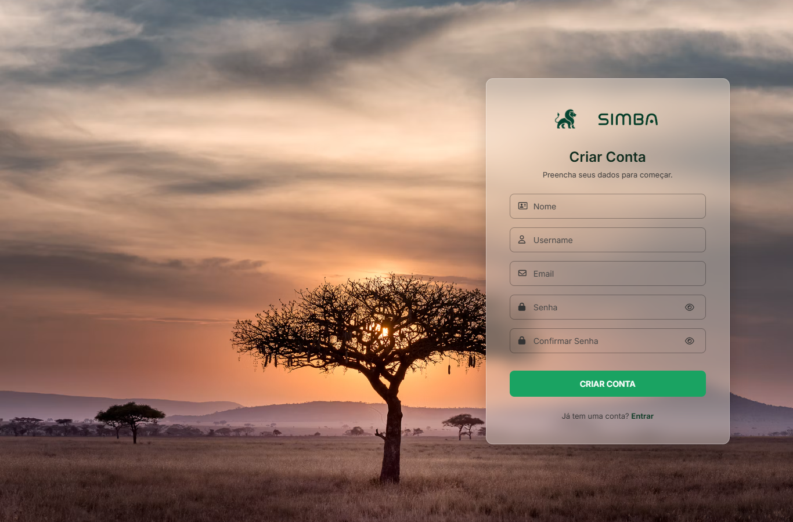

### 3.2 Entrar no sistema

1. Na tela **Entrar**, digite seu **Nome de usuário** e sua **Senha**.
2. Clique em **ENTRAR**.
3. Se os dados estiverem certos, o sistema abre a **Dashboard**.

Se aparecer "Não foi possível entrar. Verifique seu usuário e senha", confira se digitou o nome de usuário (e não o e-mail) e a senha corretamente.

Por segurança, depois de **5 senhas erradas em 15 minutos** o login daquele usuário fica bloqueado por alguns minutos e aparece "Muitas tentativas de login erradas. Tente de novo em X minutos". Espere o tempo indicado e tente de novo. Da mesma forma, um mesmo computador pode criar no máximo 10 contas por hora.

### 3.3 Tutorial de primeiro uso

Na primeira vez que você entra, o leão Simba aparece e apresenta o SIMBA em 9 passos rápidos. A tela escurece e cada parte do app fica em destaque, uma de cada vez.

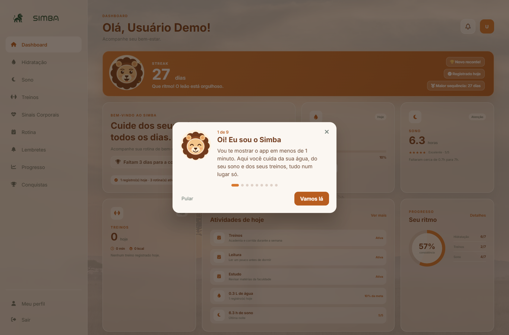

| Passo | O que o Simba mostra |
| --- | --- |
| 1 | Boas-vindas |
| 2 | A ofensiva e as expressões do leão |
| 3 | O próximo passo sugerido |
| 4 | O botão **+ 250 ml** |
| 5 | O menu de registros: Hidratação, Sono, Treinos e Sinais Corporais |
| 6 | Rotinas e lembretes |
| 7 | Progresso e conquistas |
| 8 | Meu perfil (peso e altura) |
| 9 | Convite para o primeiro registro |

Use os botões do cartão do Simba:

| Botão | O que faz |
| --- | --- |
| Vamos lá / Próximo | Vai para o próximo passo (ou seta para a direita do teclado) |
| Voltar | Volta um passo (ou seta para a esquerda) |
| Pular ou X | Fecha o tutorial (ou tecla Esc) |
| Beber 250 ml agora | No último passo, registra um copo de água e já começa sua ofensiva |
| Agora não | No último passo, fecha o tutorial sem registrar nada |

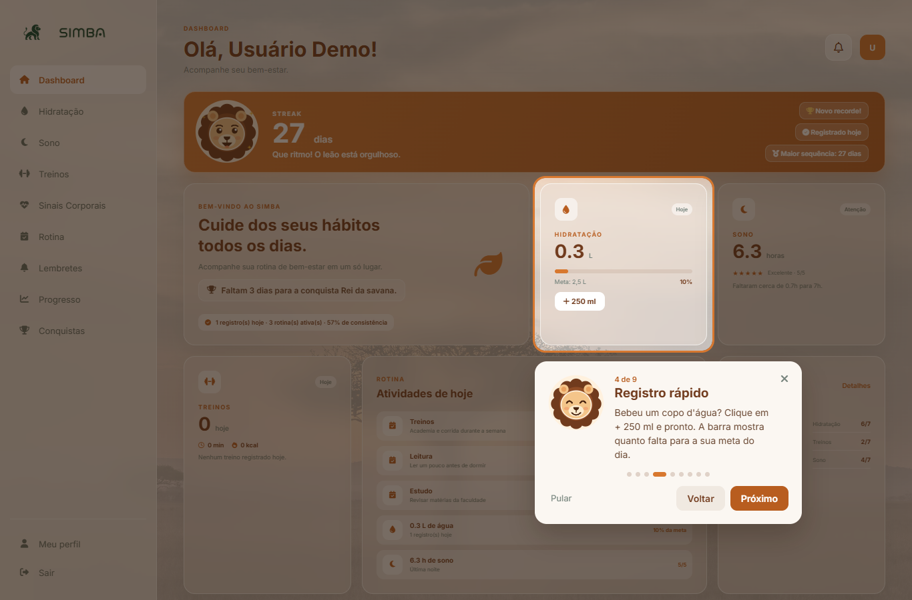

O tutorial aparece sozinho só uma vez. Para ver de novo, use **Meu perfil → Rever tutorial** (item 13.4). No celular, os passos do menu abrem o menu lateral sozinhos.

### 3.4 Sair do sistema

Clique em **Sair**, no fim do menu lateral. O sistema encerra sua sessão e volta para a tela Entrar. Fechar a aba do navegador também encerra a sessão.

---

## 4 Conhecendo a tela

### 4.1 Menu lateral

O menu fica na lateral esquerda de todas as telas. No celular, ele abre pelo botão de menu no topo.

| Item do menu | Para que serve |
| --- | --- |
| Dashboard | Tela inicial, com o resumo do seu dia |
| Hidratação | Registrar a água que você bebeu |
| Sono | Registrar a noite de sono |
| Treinos | Registrar atividades físicas |
| Sinais Corporais | Responder o questionário diário de como você está se sentindo |
| Rotina | Criar rotinas com lembretes que se repetem na semana |
| Lembretes | Criar lembretes avulsos, com data e hora |
| Progresso | Ver gráficos e o comparativo com a semana passada |
| Conquistas | Ver conquistas e criar metas |
| Meu perfil | Ver e editar seus dados, peso e altura |
| Sair | Encerrar a sessão |

### 4.2 Barra do topo

| Item | Descrição |
| --- | --- |
| Título da tela | Mostra em qual tela você está (na Dashboard, uma saudação com seu nome) |
| Sino (Notificações) | Mostra seus próximos lembretes. O número em cima do sino indica quantos há. Clique em **Ver todas** para abrir a tela Lembretes |
| Círculo com sua inicial | Atalho para o Meu perfil |

### 4.3 Avisos na tela

Quando você salva algo, o SIMBA mostra um aviso no canto superior direito. Os avisos dizem se deu certo, se sua ofensiva do dia foi garantida, se você ganhou uma conquista ou concluiu uma meta. Com o sistema aberto, os lembretes também aparecem como aviso na hora marcada.

No canto **inferior** direito aparecem os **alertas de saúde**, quando sono, água ou treinos ficam abaixo do esperado por vários dias (item 5.5).

---

## 5 Dashboard

A Dashboard é a primeira tela depois do login. Ela mostra o resumo do seu dia e o que vale a pena fazer agora.

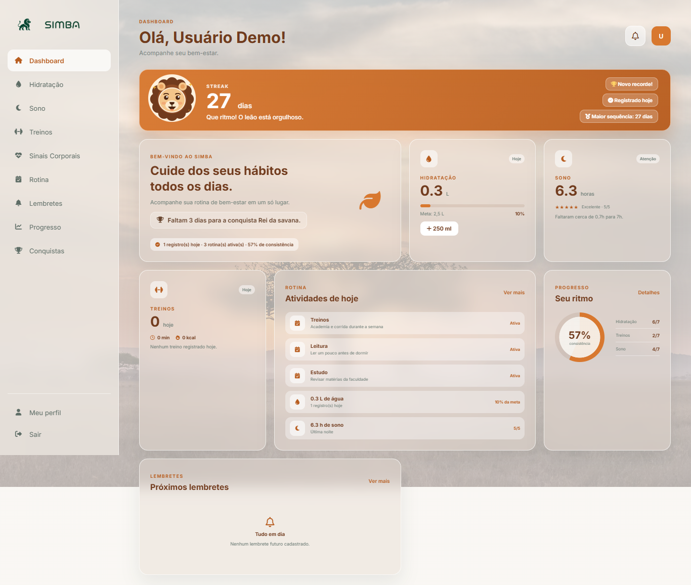

### 5.1 Ofensiva e o leão Simba

No topo fica o quadro da **ofensiva** (streak): quantos dias seguidos você usa o SIMBA. Um dia conta quando você registra qualquer coisa (água, sono ou treino). À direita aparecem selos como "Ofensiva em risco", "Falta registrar hoje" e "Maior sequência". O leão muda de expressão conforme a situação:

| Expressão do leão | Quando aparece |
| --- | --- |
| Início | Você ainda não começou uma ofensiva |
| Feliz | Ofensiva ativa, de 1 a 6 dias |
| Preocupado | Você tem ofensiva, mas ainda não registrou nada hoje |
| Medo | A ofensiva está em risco: ontem (ou anteontem) ficou sem registro |
| Animado | 7 dias ou mais de ofensiva |
| Rei | 30 dias ou mais de ofensiva |
| Triste | A ofensiva zerou |

As regras completas da ofensiva estão no capítulo 14.

### 5.2 Próximo passo

No quadro de boas-vindas aparece uma sugestão destacada, por exemplo "Sua ofensiva de 26 dias está em risco. Registre algo hoje!". Clique nela para ir direto à tela certa. O SIMBA escolhe uma sugestão por vez, nesta ordem: salvar a ofensiva em risco, terminar uma meta ou conquista quase pronta, a água de hoje, a meta ativa, a conquista mais próxima.

### 5.3 Cartões do dia

| Cartão | O que mostra |
| --- | --- |
| Hidratação | Litros bebidos hoje, sua meta e a porcentagem atingida. O botão **+ 250 ml** registra um copo na hora |
| Sono | Horas da última noite e a nota (de 1 a 5 estrelas) |
| Treinos | Treinos de hoje, minutos e calorias |
| Rotina – Atividades de hoje | Suas rotinas ativas e a última noite de sono. **Ver mais** abre a tela Rotina |
| Progresso – Seu ritmo | Sua consistência nos últimos 7 dias, em porcentagem: dias com água, com treino e com sono. **Detalhes** abre a tela Progresso |
| Lembretes – Próximos lembretes | Seus próximos lembretes. **Ver mais** abre a tela Lembretes |

### 5.4 Registro rápido de água

1. No cartão Hidratação, clique em **+ 250 ml**.
2. O SIMBA registra 250 ml com a hora atual e atualiza a porcentagem da meta.
3. Se for o primeiro registro do dia, aparece o aviso de que sua ofensiva do dia está garantida.

### 5.5 Alertas de saúde

Quando uma das suas métricas fica abaixo do esperado **por vários dias seguidos**, o SIMBA mostra um alerta no canto inferior direito da Dashboard:

| Alerta | Quando aparece |
| --- | --- |
| Seu sono precisa de atenção | Nas suas 4 últimas noites registradas você dormiu menos de 7 horas ou deu nota 1 ou 2 |
| Hidratação abaixo do esperado | Nos seus 3 últimos dias com registro (sem contar hoje), você bebeu menos da metade da sua meta de água |
| Muitos dias sem atividade física | Você não registrou nenhum treino nos últimos 14 dias (só para quem usa o SIMBA há 14 dias ou mais) |

Cada alerta diz o que foi percebido nos seus registros, **sugere conversar com um médico ou outro profissional de saúde** se o padrão continuar e lembra que **o SIMBA tem finalidade preventiva e de autocuidado: as orientações não substituem a avaliação nem o diagnóstico de um profissional de saúde**.

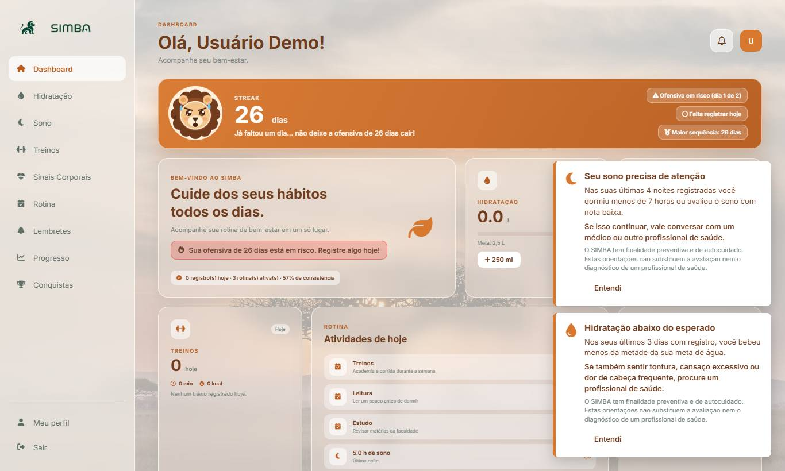

Clique em **Entendi** para esconder o alerta até o fim do dia. Quando a métrica volta ao normal (por exemplo, uma boa noite de sono entre as últimas 4), o alerta some sozinho. As telas de Hidratação e Treinos também mostram o alerta da sua métrica; a tela de Sono mostra o aviso do item 7.4.

### 5.6 Notificações

Clique no sino, no canto superior direito, para ver os próximos lembretes.

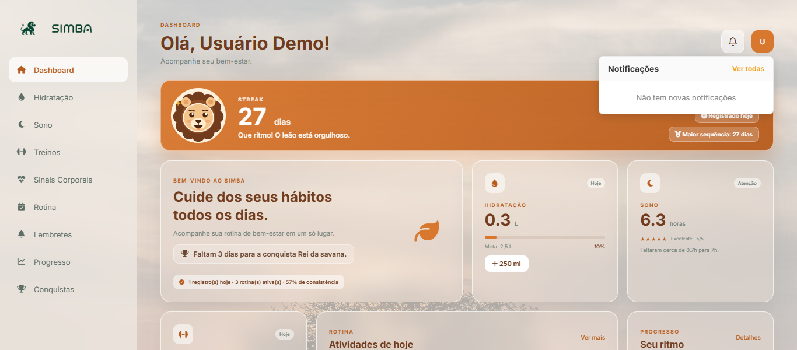

---

## 6 Hidratação

Na tela Hidratação você registra a água que bebe e acompanha quanto falta para a meta do dia.

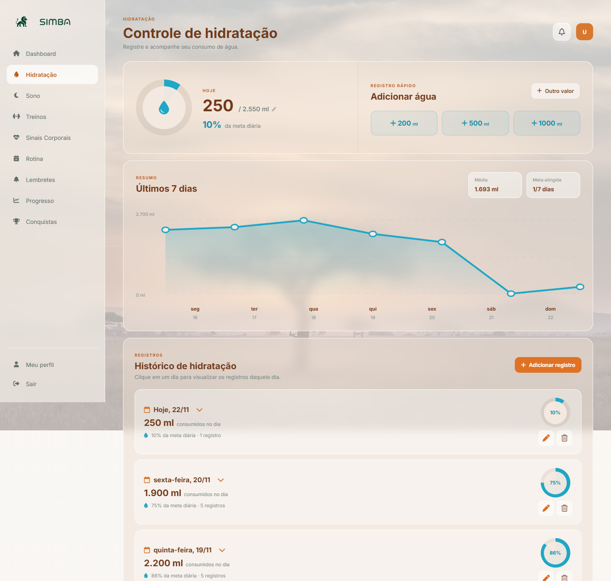

### 6.1 Partes da tela

| Parte | O que mostra |
| --- | --- |
| Hoje | Quanto você bebeu hoje, a meta diária em ml (com um lápis para editar) e a porcentagem atingida |
| Registro rápido – Adicionar água | Botões **+ 200 ml**, **+ 500 ml** e **+ 1000 ml**, e o botão **Outro valor** |
| Resumo – Últimos 7 dias | Gráfico dos últimos 7 dias, média diária e em quantos dias a meta foi atingida |
| Histórico de hidratação | Os registros agrupados por dia. Clique em um dia para ver os registros dele |

### 6.2 Registrar água

Jeito rápido: clique em **+ 200 ml**, **+ 500 ml** ou **+ 1000 ml**. O registro é salvo com a hora atual.

Outro valor ou outro dia:

1. Clique em **Outro valor** (ou **Adicionar registro**, no histórico).
2. Em **Quantidade**, digite os ml (exemplo: 500).
3. Em **Data e horário**, deixe a hora atual ou mude para lançar um registro de outro dia.
4. Clique em **Salvar registro**.

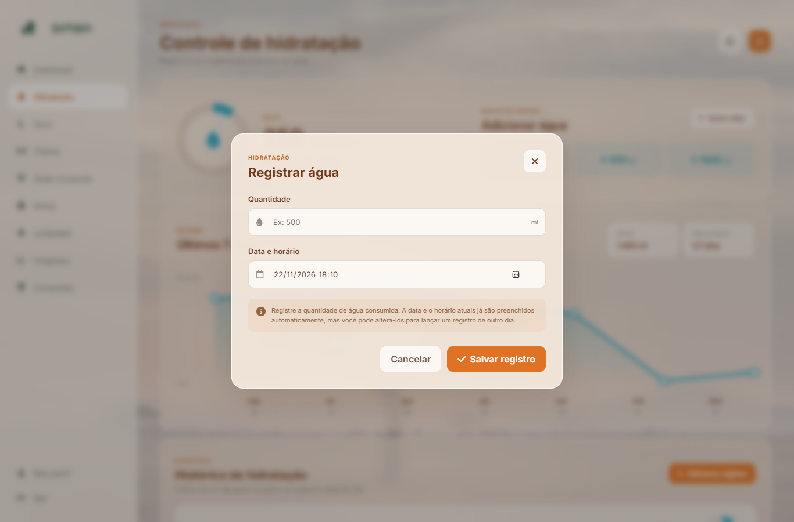

### 6.3 Editar ou excluir registros

1. No **Histórico de hidratação**, clique no dia desejado para ver os registros dele.
2. Use o lápis para editar ou a lixeira para excluir.
3. Para excluir, confirme na mensagem "Deseja realmente excluir este registro de água?". A lixeira do cartão do dia exclui todos os registros daquele dia.

### 6.4 Meta diária de água

O SIMBA sugere uma meta com base no seu peso: **35 ml por quilo**, entre 1.500 e 5.000 ml. Sem peso cadastrado, a sugestão é 2.000 ml. Para mudar:

1. No quadro **Hoje**, clique no lápis ao lado da meta.
2. Em **Quantidade por dia**, digite o valor (de 500 a 8.000 ml).
3. Clique em **Salvar meta**. Para voltar ao valor calculado, clique em **Usar a sugerida**.

### 6.5 Alerta de hidratação baixa

Se nos seus 3 últimos dias com registro (sem contar hoje) você bebeu menos da metade da meta, a tela Hidratação mostra o alerta "Hidratação abaixo do esperado" no canto inferior direito, com a orientação de procurar um profissional de saúde se também sentir tontura, cansaço excessivo ou dor de cabeça frequente. Depois de cada registro de água o alerta é recalculado. Veja o item 5.5.

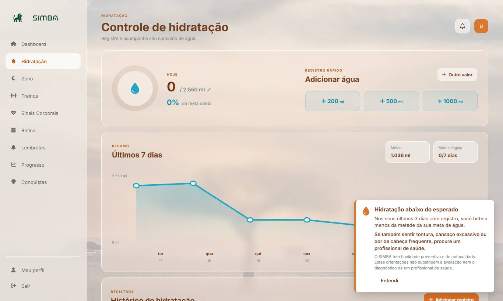

---

## 7 Sono

Na tela Sono você planeja a hora de dormir e registra como foi cada noite.

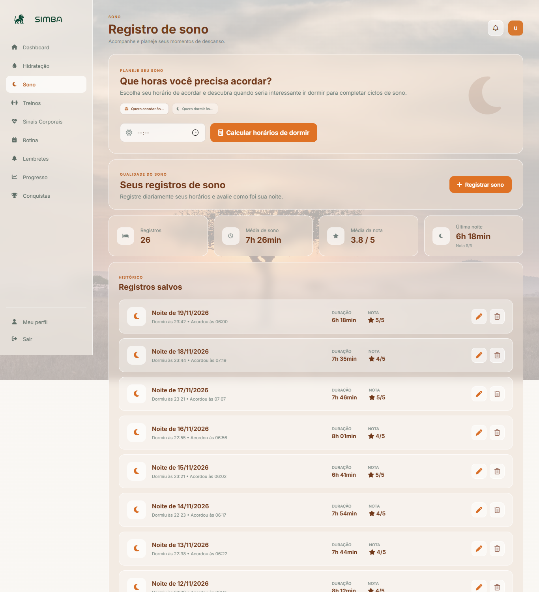

### 7.1 Planejar o sono

O quadro **Planeje seu sono** calcula bons horários com base em ciclos de sono de cerca de 90 minutos, mais uns 15 minutos para pegar no sono.

1. Escolha **Quero acordar às...** ou **Quero dormir às...** e informe o horário.
2. Clique em **Calcular horários de dormir**.
3. O SIMBA mostra três opções: 5 ciclos (cerca de 7h30), 6 ciclos (cerca de 9h) e 7 ciclos (cerca de 10h30).

Os horários são estimativas, não recomendação médica.

### 7.2 Registrar uma noite de sono

1. Clique em **Registrar sono**.
2. Preencha **Quando você foi dormir?** e **Quando você acordou?**. A **Duração calculada** aparece sozinha.
3. Em **Como você avalia sua noite?**, escolha uma nota de 1 (ruim) a 5 (ótima).
4. Clique em **Salvar registro**.

O registro conta para a ofensiva no dia em que você **acordou**.

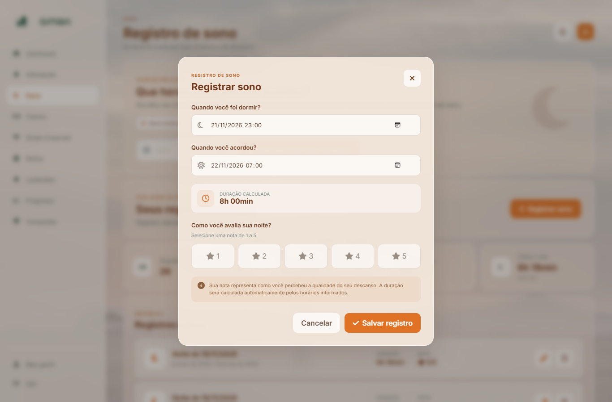

### 7.3 Resumo e histórico

O quadro **Seus registros de sono** mostra o total de registros, a média de sono, a média da nota e a última noite. Em **Registros salvos** ficam todas as noites, com horário de dormir e acordar, duração e nota. Use o lápis para editar e a lixeira para excluir.

### 7.4 Aviso de sono ruim

Quando três das suas noites registradas tiverem nota 1 ou 2, o SIMBA mostra, logo depois do registro, o aviso "Atenção com seu sono". Ele sugere ajustar a rotina de descanso, orienta a **conversar com um médico ou outro profissional de saúde** se isso continuar e lembra que o SIMBA é preventivo e **não substitui a avaliação nem o diagnóstico de um profissional**. O aviso fica alguns segundos no canto superior direito.

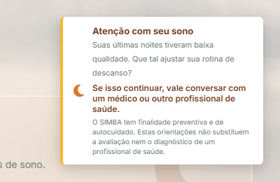

Na Dashboard também aparece o alerta "Seu sono precisa de atenção" quando as 4 últimas noites foram ruins (item 5.5).

---

## 8 Treinos

Na tela Treinos você registra as atividades físicas. O topo mostra quantos treinos você registrou, o tempo total e o gasto estimado de calorias.

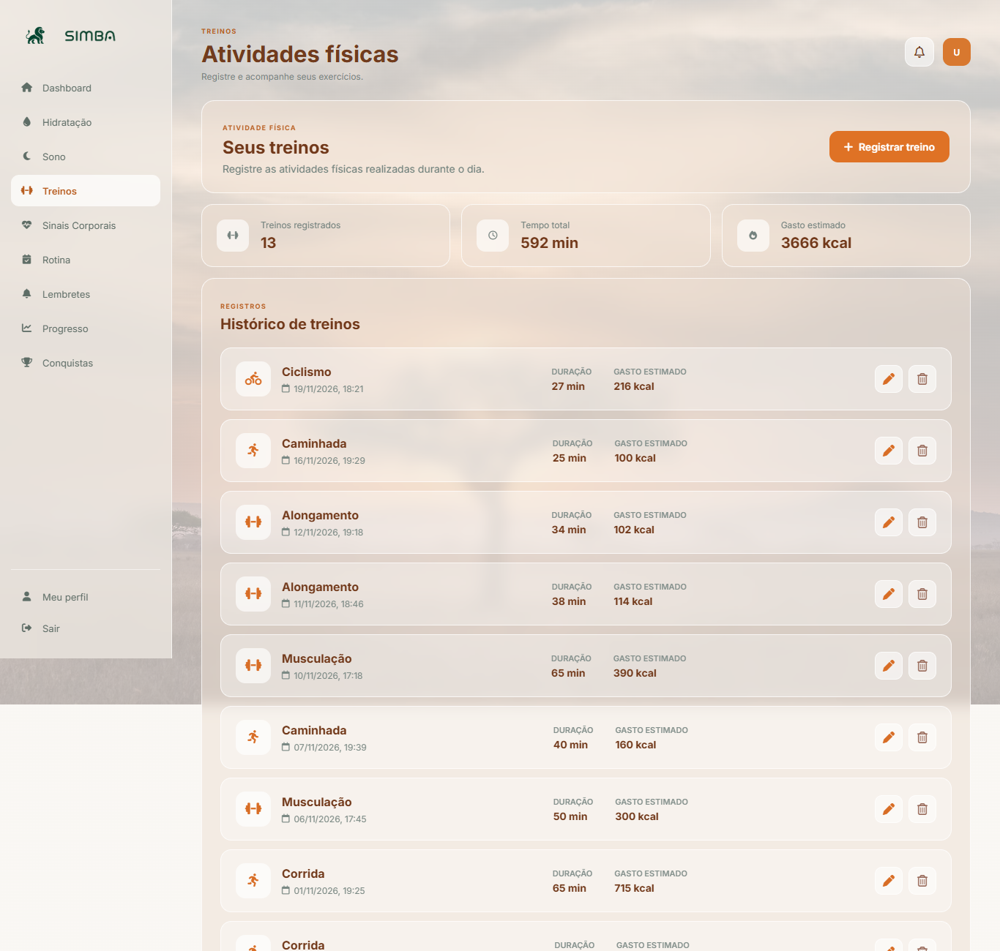

### 8.1 Registrar um treino

1. Clique em **Registrar treino**.
2. Preencha os campos:

| Campo | O que informar |
| --- | --- |
| Modalidade | Caminhada, Corrida, Musculação, Ciclismo, Natação, Futebol, Vôlei, Alongamento ou Outro |
| Duração | Minutos de atividade (exemplo: 60) |
| Gasto calórico | Opcional. Calorias estimadas (exemplo: 350) |
| Data e horário | Quando o treino foi feito |

3. Clique em **Salvar treino**.

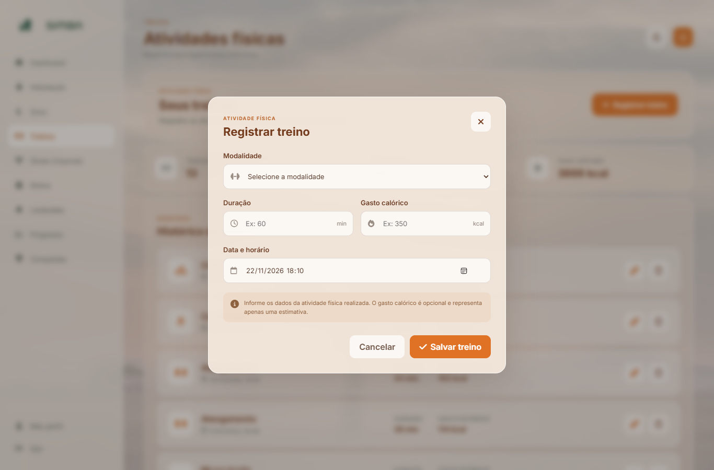

### 8.2 Editar ou excluir um treino

No **Histórico de treinos**, use o lápis para editar ou a lixeira para excluir. Para excluir, confirme na mensagem "Deseja realmente excluir este treino?".

### 8.3 Alerta de muitos dias sem atividade

Para quem já usa o SIMBA há pelo menos 14 dias, se nenhum treino for registrado nos últimos 14 dias a tela Treinos (e a Dashboard) mostra o alerta "Muitos dias sem atividade física". Ele sugere retomar aos poucos e conversar com um profissional de saúde se sentir desconforto ou tiver alguma condição de saúde. Registrar um treino faz o alerta sumir. Veja o item 5.5.

---

## 9 Rotinas e lembretes

O SIMBA tem dois tipos de lembrete:

| Tipo | Onde fica | Como repete |
| --- | --- | --- |
| Lembrete de rotina | Tela **Rotina** | Repete toda semana, no horário e nos dias escolhidos |
| Lembrete avulso | Tela **Lembretes** | Acontece uma vez, na data e hora marcadas |

### 9.1 Criar uma rotina

Uma rotina agrupa lembretes de um mesmo hábito. Exemplo: a rotina "Treinos" tem o lembrete "Hora de treinar" às 18h, segunda, quarta e sexta.

1. No menu, clique em **Rotina**.
2. No quadro **Crie uma rotina**, digite o **Nome da rotina** (exemplo: Treinos, Leitura, Estudo).
3. Se quiser, preencha a **Descrição**.
4. Clique em **Criar rotina**. Ela aparece em **Rotinas cadastradas**.

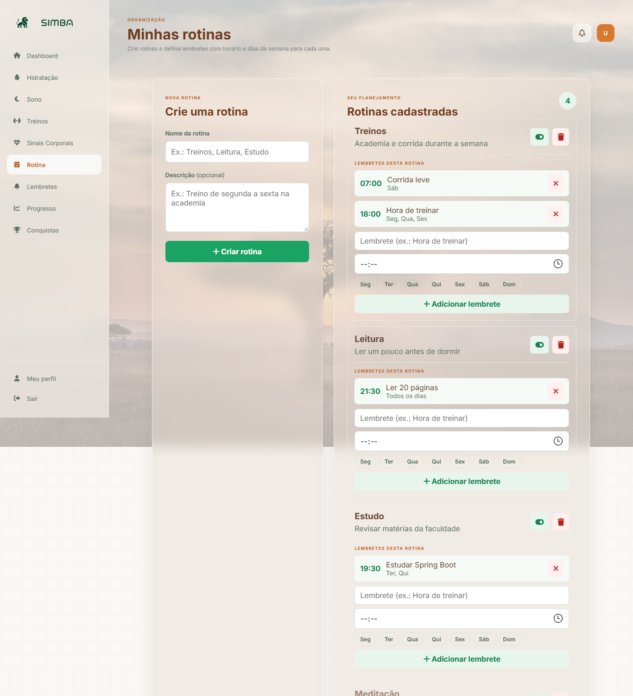

### 9.2 Adicionar lembretes a uma rotina

1. No cartão da rotina, em **Lembretes desta rotina**, digite o nome do lembrete (exemplo: Hora de treinar).
2. Escolha o horário.
3. Marque os dias da semana em que ele se repete (Seg a Dom). É preciso marcar pelo menos um dia.
4. Clique em **Adicionar lembrete**.

O lembrete aparece com o horário e os dias (por exemplo "Seg, Qua, Sex" ou "Todos os dias").

| Botão no cartão da rotina | O que faz |
| --- | --- |
| Interruptor (verde) | Ativa ou desativa a rotina |
| Lixeira vermelha | Exclui a rotina inteira (pede confirmação) |
| X ao lado de um lembrete | Remove aquele lembrete |

As rotinas ativas aparecem no cartão Rotina da Dashboard.

### 9.3 Lembretes avulsos

1. No menu, clique em **Lembretes**.
2. Em **Adicionar lembrete**, preencha o **Título** (exemplo: Beber água), a **Mensagem** (exemplo: Faça uma pausa e hidrate-se) e a **Data e horário**.
3. Clique em **Adicionar lembrete**.

O topo da tela mostra quantos lembretes estão cadastrados e o horário do próximo. Em **Seus lembretes** fica a lista completa. O botão **Atualizar** recarrega a lista, e a lixeira exclui um lembrete.

Com o SIMBA aberto no navegador, o lembrete aparece como aviso na tela na hora marcada. Ele também aparece no sino de notificações.

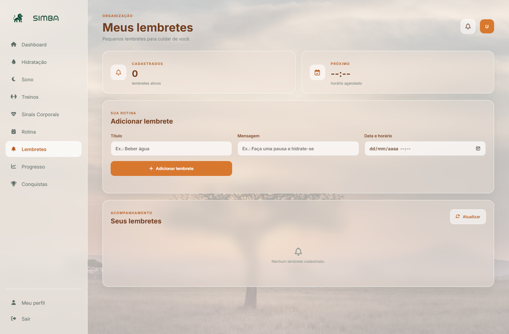

---

## 10 Sinais Corporais

Os Sinais Corporais são um check-in rápido, uma vez por dia, para você perceber padrões no seu corpo. Leva menos de 1 minuto.

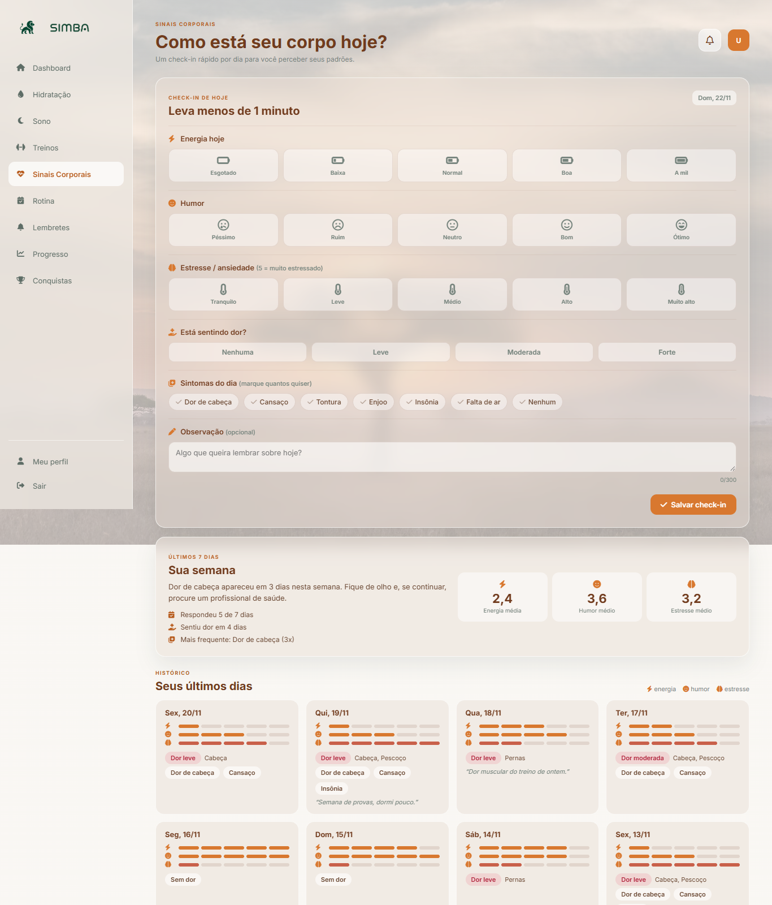

### 10.1 Responder o check-in de hoje

1. No menu, clique em **Sinais Corporais**.
2. Responda as perguntas:

| Pergunta | Opções |
| --- | --- |
| Energia hoje | Esgotado, Baixa, Normal, Boa, A mil |
| Humor | Péssimo, Ruim, Neutro, Bom, Ótimo |
| Estresse / ansiedade | Tranquilo, Leve, Médio, Alto, Muito alto |
| Está sentindo dor? | Nenhuma, Leve, Moderada, Forte |
| Onde dói? | Aparece se houver dor. Marque uma ou mais partes: Cabeça, Pescoço, Peito, Estômago, Braços, Costas, Lombar, Pernas, Músculos em geral, Outro |
| Sintomas do dia | Marque quantos quiser: Dor de cabeça, Cansaço, Tontura, Enjoo, Insônia, Falta de ar ou Nenhum |
| Observação | Opcional, até 300 caracteres |

3. Clique em **Salvar check-in**. O quadro passa a mostrar **Respondido!**

Para mudar a resposta do dia, clique em **Editar**.

### 10.2 Sua semana e histórico

O quadro **Sua semana** resume os últimos 7 dias: quantos dias você respondeu, em quantos sentiu dor, o sintoma mais frequente e as médias de energia, humor e estresse. Quando um sintoma se repete, o SIMBA sugere procurar um profissional de saúde. Em **Seus últimos dias** ficam as respostas anteriores, com barras de energia, humor e estresse.

Os Sinais Corporais servem para acompanhamento pessoal. Eles não substituem uma consulta médica.

---

## 11 Progresso

Na tela Progresso você vê a evolução dos seus hábitos em gráficos.

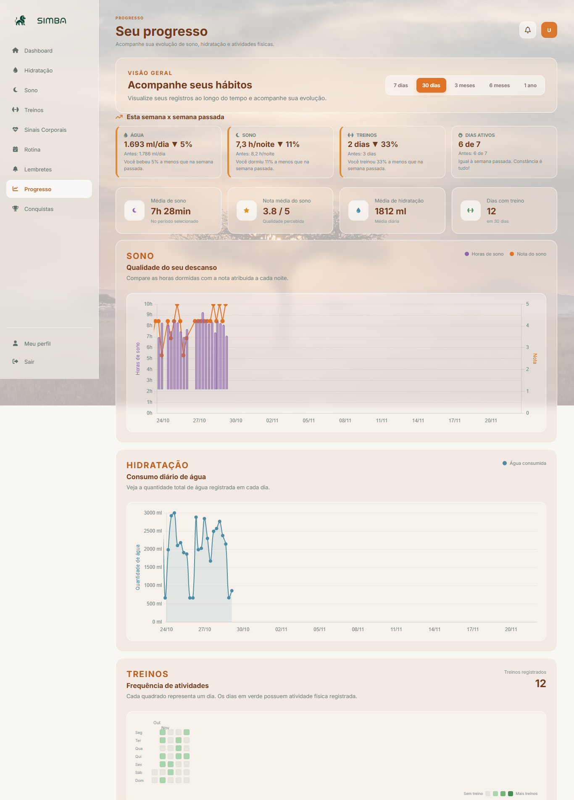

### 11.1 Escolher o período

No topo, clique em **7 dias**, **30 dias**, **3 meses**, **6 meses** ou **1 ano**. Os números e gráficos mudam para o período escolhido.

### 11.2 Visão geral

| Indicador | O que significa |
| --- | --- |
| Média de sono | Horas dormidas por noite, em média |
| Nota média do sono | Média das notas de 1 a 5 que você deu às noites |
| Média de hidratação | Água bebida por dia, em média |
| Dias com treino | Quantos dias tiveram pelo menos um treino |

### 11.3 Esta semana × semana passada

O comparativo coloca os últimos 7 dias ao lado dos 7 dias anteriores: média de água por dia, média de horas de sono, dias com treino e dias ativos. Cada item diz se você melhorou, piorou ou ficou igual, por exemplo "Você bebeu 12% a mais que na semana passada".

### 11.4 Gráficos

| Gráfico | O que mostra |
| --- | --- |
| Sono – Qualidade do seu descanso | As horas dormidas e a nota de cada noite |
| Hidratação – Consumo diário de água | A água registrada em cada dia |
| Treinos – Frequência de atividades | Um quadrado por dia. Quanto mais forte a cor, mais treinos no dia |

---

## 12 Conquistas e metas

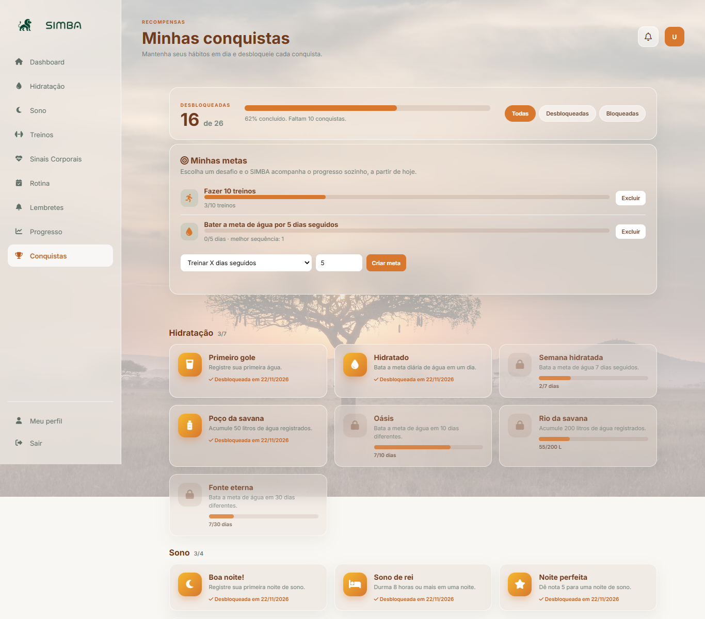

### 12.1 Conquistas

O SIMBA tem **26 conquistas** que se desbloqueiam sozinhas conforme você usa o app. Elas estão divididas em seis categorias: Hidratação, Sono, Treinos, Rotinas, Ofensiva e Geral. Exemplos:

| Conquista | Como ganhar |
| --- | --- |
| Primeiro gole | Registrar sua primeira água |
| Semana hidratada | Bater a meta de água 7 dias seguidos |
| Boa noite! | Registrar sua primeira noite de sono |
| Fornalha | Queimar 1.000 kcal somando seus treinos |
| Atleta completo | Treinar 3 modalidades diferentes |
| Organizado | Criar sua primeira rotina |
| Dia completo | Registrar água, sono e treino no mesmo dia |

No topo aparece quantas conquistas você já desbloqueou (por exemplo "16 de 26"). Use os filtros **Todas**, **Desbloqueadas** e **Bloqueadas** para ver cada grupo. As conquistas bloqueadas mostram uma barra de progresso. Uma conquista recém-ganha aparece com o selo "Nova" e gera o aviso "Conquista desbloqueada!".

### 12.2 Criar uma meta

Uma meta é um desafio que você escolhe. O SIMBA acompanha o progresso sozinho, contando a partir do dia em que a meta foi criada.

1. Na tela **Conquistas**, vá até o quadro **Minhas metas**.
2. Na lista, escolha o tipo de desafio:
    - Treinar X dias seguidos
    - Bater a meta de água X dias seguidos
    - Dormir 7 h ou mais X noites seguidas
    - Fazer X treinos
3. No campo ao lado, digite o número do desafio (o X).
4. Clique em **Criar meta**. Aparece "Meta criada! O progresso conta a partir de hoje."

Cada meta mostra uma barra de progresso (por exemplo "3/10 treinos"). Você pode ter até **5 metas ativas**, e só uma de cada tipo. Para apagar uma meta, clique em **Excluir**.

### 12.3 Concluir e aumentar o desafio

Quando você atinge o alvo, a meta aparece como **Concluída!** Clique em **Aumentar desafio** para criar na hora uma meta parecida, com um alvo maior.

---

## 13 Meu perfil

Na tela Meu perfil você vê os dados da conta (nome, nome de usuário e e-mail) e gerencia suas configurações.

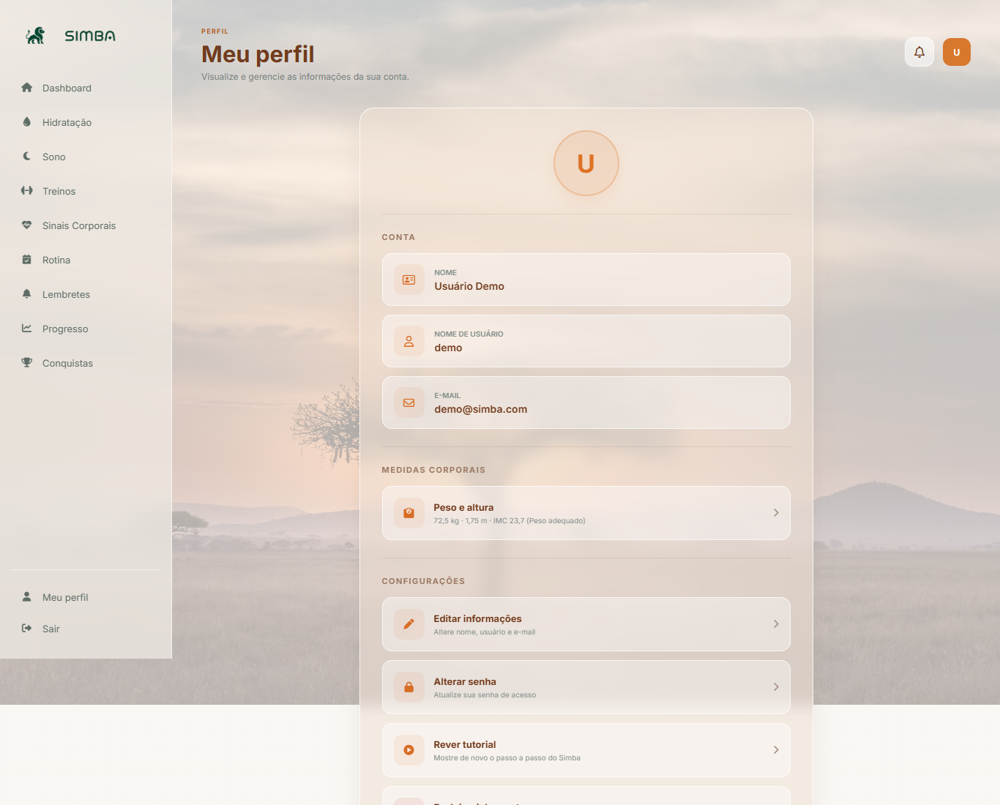

### 13.1 Editar informações

1. Em **Configurações**, clique em **Editar informações**.
2. Altere o **Nome**, o **Nome de usuário** ou o **E-mail**.
3. Clique em **Salvar alterações**. Se mudar o nome de usuário, sua sessão é atualizada sozinha. Use o nome novo no próximo login.

### 13.2 Alterar senha

1. Clique em **Alterar senha**.
2. Digite a **Senha atual**, a **Nova senha** e repita em **Confirmar nova senha**.
3. Clique em **Alterar senha**. A senha atual é conferida antes de salvar a nova.

### 13.3 Peso, altura e IMC

1. Em **Medidas corporais**, clique em **Adicionar peso e altura** (ou em **Peso e altura**, se já preencheu antes).
2. Informe o **Peso** em kg (exemplo: 72,5) e a **Altura** em cm (exemplo: 175). Deixe em branco o que não quiser informar.
3. O SIMBA calcula o **IMC** na hora e mostra a faixa: Abaixo (menos de 18,5), Adequado (18,5 a 24,9), Sobrepeso (25 a 29,9) ou Obesidade (30 ou mais).
4. Clique em **Salvar medidas**.

O IMC é o peso dividido pela altura ao quadrado. Exemplo: 75 kg e 1,80 m dão 75 ÷ 3,24 = 23,1. É uma referência para adultos (faixas da OMS) e não diferencia músculo de gordura.

Com o peso preenchido, o SIMBA calcula sua meta de água e mostra **Sugestões de metas**. Clique em **Ver metas** para ir à tela Conquistas. As sugestões são gerais e não substituem a orientação de um profissional de saúde.

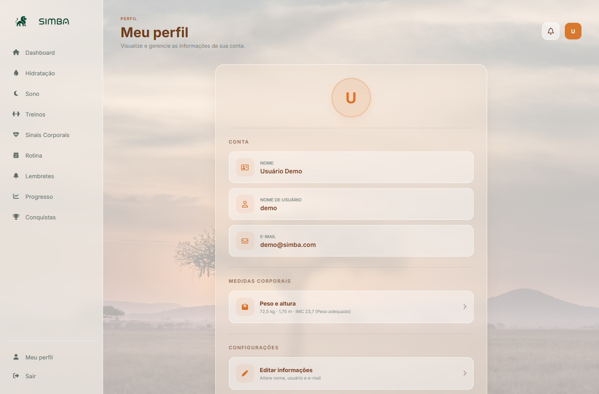

### 13.4 Rever tutorial

1. Em **Configurações**, clique em **Rever tutorial**.
2. O SIMBA volta para a Dashboard e o leão Simba mostra o passo a passo de novo (item 3.3).

### 13.5 Excluir minha conta

> **Atenção: esta ação é permanente.** A conta e todos os seus dados são apagados: registros de água, sono e exercícios, metas, rotinas e conquistas. Não é possível recuperar.

1. Em **Configurações**, clique em **Excluir minha conta**.
2. Em **Confirme sua senha atual**, digite sua senha.
3. Em **Digite EXCLUIR para confirmar**, digite **EXCLUIR**.
4. Clique em **Excluir definitivamente**.

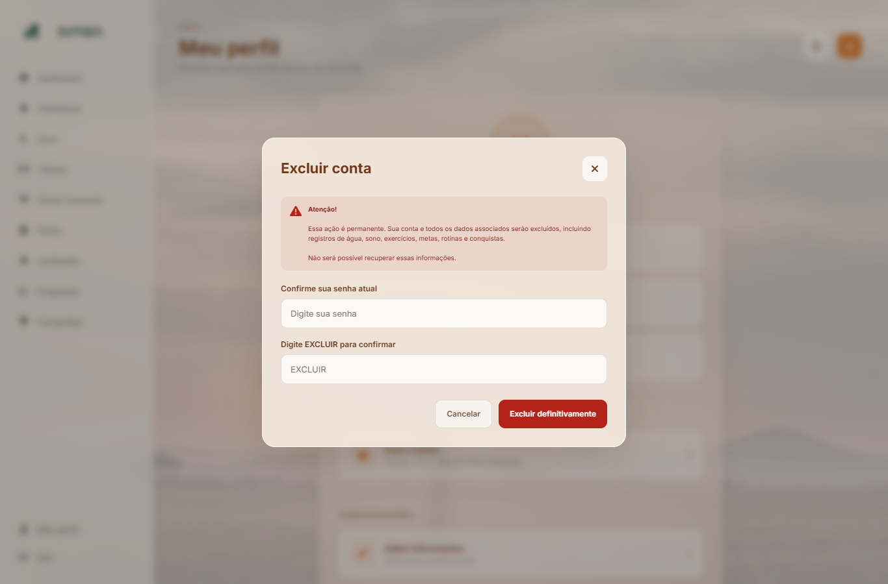

---

## 14 Dúvidas frequentes

### 14.1 Como funciona a ofensiva?

A ofensiva conta quantos dias seguidos você registrou algo no SIMBA (água, sono ou treino). Ela tem uma tolerância para dias em que você esquece:

- **Hoje sem registro não conta como falta.** Você tem até o fim do dia para registrar.
- **1 dia sem registro:** a ofensiva fica **em risco** e o leão fica com cara de medo.
- **2 dias seguidos sem registro:** é a **última chance**. Registre algo hoje para salvar a ofensiva.
- **A ofensiva zera** se houver mais de 2 faltas seguidas ou mais de 2 faltas dentro de 7 dias.

Os dias seguem o horário de Brasília.

### 14.2 Perguntas comuns

| Pergunta | Resposta |
| --- | --- |
| Esqueci de registrar a água de ontem. Dá para lançar depois? | Sim. Em Hidratação, clique em **Outro valor** e mude a **Data e horário** para ontem |
| Por que minha meta de água mudou? | Ela é calculada pelo seu peso. Se você atualizou o peso no perfil, a sugestão muda. Você pode definir um valor fixo (item 6.4) |
| Criei uma meta e o progresso está zerado | As metas só contam registros feitos a partir do dia em que foram criadas |
| Não consigo criar outra meta | O limite é de 5 metas ativas, e só uma de cada tipo. Exclua ou conclua uma antes |
| O lembrete não apareceu na hora | O aviso só aparece com o SIMBA aberto no navegador |
| Fui desconectado do sistema | A sessão termina ao fechar o navegador ou clicar em Sair. Entre de novo com usuário e senha |
| Desliguei o sistema. Perco meus registros? | Não. Os dados ficam guardados no banco de dados e continuam lá quando o sistema é ligado de novo (item 2.3) |
| Apareceu "Muitas tentativas de login erradas" | Você errou a senha 5 vezes em 15 minutos. Espere os minutos indicados e tente de novo (item 3.2) |
| Apareceu um alerta dizendo para procurar um profissional | É um alerta preventivo: uma métrica ficou abaixo do esperado por vários dias (item 5.5). Ele não é um diagnóstico. Se o padrão continuar, converse com um profissional de saúde |
| O alerta não some | Ele some quando a métrica volta ao normal, ou fica escondido até o fim do dia ao clicar em **Entendi** |
| Pulei o tutorial. Como vejo de novo? | Em **Meu perfil**, clique em **Rever tutorial** |
| O tutorial apareceu de novo em outro computador | O SIMBA lembra que você já viu o tutorial só no navegador onde ele foi visto. Em outro computador ele aparece mais uma vez. Basta clicar em **Pular** |
| Esqueci minha senha | Esta versão ainda não tem recuperação de senha. Fale com a equipe |

### 14.3 Aviso importante

O SIMBA é uma ferramenta de acompanhamento de hábitos. Ele não faz diagnóstico e não substitui a orientação de médicos, nutricionistas ou educadores físicos.
